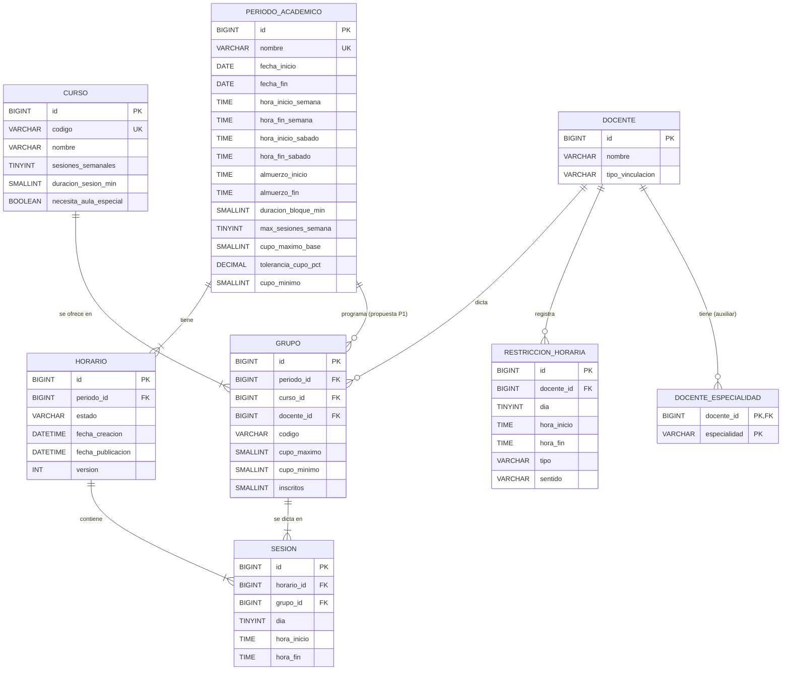

# Análisis del modelo de datos — Fase 2: base de datos

**Módulo de Asignación de Horarios Docente-Curso** · Universidad El Bosque · Programa de Ingeniería de Sistemas · Proyecto Núcleo 1

> **Actualizado en la segunda revisión técnica (esquema V2, 21-oct-2026).** Los cambios de V2 y las decisiones nuevas D1–D4 están en `INFORME_REVISION_TECNICA.md`; el contrato JPA vigente está en `CONTRATO_JPA.md`, generado desde el esquema. Este documento conserva el análisis del modelo, que no cambió estructuralmente.

Este documento reúne los entregables A (análisis), B (modelo entidad-relación), el contrato de integración con Spring Boot/JPA (sección 11 del encargo) y la lista de verificación final (paso 8). Los scripts están en `01_schema.sql` a `04_tests.sql` y la operación del entorno en `README_BD.md`.

---

## Paso 1. Reconstrucción del modelo original

Fuente principal: Informe técnico de la primera entrega, Capítulo 5 (Figura 4, Tabla 17, secciones 5.3.1, 5.3.2 y 5.6). Complementos: Tablas 9, 10, 13, 14, 15, 19 y 26 del mismo informe, y la Tabla 4 del documento 04 (vacíos 10 a 12).

**Figura 4: multiplicidades leídas directamente del diagrama**

| Asociación | Lado "uno" | Lado "muchos" | Lectura |
|---|---|---|---|
| PeriodoAcademico – Horario | 1 | 1..* | Todo horario tiene periodo; un periodo tiene al menos un horario (conceptual). |
| Curso – Grupo | 1 | 1..* | Todo grupo tiene curso; un curso tiene al menos un grupo (conceptual). |
| Docente – Grupo | 1 | 0..* | Todo grupo tiene docente; un docente puede no tener grupos. |
| Docente – RestriccionHoraria | 1 | 0..* | Toda restricción tiene docente; un docente puede no tener restricciones. |
| Horario – Sesion | 1 | 1..* | Toda sesión tiene horario. |
| Grupo – Sesion | 1 | 1..* | Toda sesión tiene grupo. |

**Atributos de la Figura 4 y la Tabla 17:** PeriodoAcademico (id, nombre, fechaInicio, fechaFin, parámetros configurables); Curso (id, nombre, sesionesSemanales 1 a 4, duracionSesion 2 h, necesitaAulaEspecial); Docente (id, nombre, tipoVinculacion TC, 3/4, 1/2, 1/4); Horario (id, estado borrador/publicado); Grupo (id, cupoMaximo, cupoMinimo, inscritos); RestriccionHoraria (id, dia, horaInicio/horaFin, tipo firme/preferencia); Sesion (id, dia, bloque).

**Cómo se trasladan las multiplicidades mínimas.** En el lado "uno" (la FK), la obligatoriedad se impone con `NOT NULL`. Los mínimos `1..*` del lado "muchos" (un periodo con al menos un horario, un curso con al menos un grupo, un grupo o un horario con al menos una sesión) **no se imponen en MySQL**. Son condiciones del ciclo de vida: un periodo se crea antes que sus horarios, un curso antes que sus grupos y un horario antes que sus sesiones. Imponerlas exigiría inserciones circulares o triggers diferidos, que MySQL no ofrece. Se tratan como reglas del backend (por ejemplo, un horario sin sesiones no se puede publicar).

---

## Paso 2. Decisiones de diseño

Origen: **DOC** = viene de los documentos aprobados · **SUP** = suposición vigente documentada (Tabla 13) · **PT** = propuesta técnica nueva de esta fase, pendiente de validación.

| # | Decisión | Origen | Justificación |
|---|---|---|---|
| D01 | Siete tablas para las siete entidades: `periodo_academico`, `docente`, `restriccion_horaria`, `curso`, `grupo`, `horario`, `sesion`. | DOC (Fig. 4) | Fidelidad al modelo aprobado. |
| D02 | `tipo_vinculacion` es una columna enumerada (`TC`, `TRES_CUARTOS`, `MEDIO_TIEMPO`, `CUARTO_TIEMPO`) con CHECK, no una tabla. | DOC (5.3.1) | Valor sin comportamiento ni relaciones. Los nombres son válidos como constantes Java. |
| D03 | `estado` del horario es una columna con solo `BORRADOR` y `PUBLICADO`. | DOC (5.3.1, Tabla 14) | No se agregan estados. |
| D04 | `necesita_aula_especial` es un BOOLEAN de `curso`, sin tablas de aulas. | DOC (5.3.1) | La gestión de aulas queda fuera de alcance. |
| D05 | Los parámetros institucionales son **columnas de `periodo_academico`**, sin tabla auxiliar. | DOC (Fig. 4: "parámetros configurables" es atributo de PeriodoAcademico) | El conjunto de parámetros es fijo y pequeño. Como columnas tipadas admiten CHECK (`almuerzo_fin > almuerzo_inicio`) y se mapean a campos Java simples. Una tabla clave-valor perdería tipos y restricciones. Cada periodo guarda sus cifras, así que el histórico conserva las reglas con que se armó. |
| D06 | Especialidades en la tabla auxiliar `docente_especialidad (docente_id, especialidad)`. | PT (RF01 sí pide especialidades) | La Figura 4 no muestra el atributo, pero RF01 lo exige. Una lista separada por comas violaría la 1FN. Es una **colección de valores** (`@ElementCollection`), no una entidad: no tiene id propio ni relaciones. |
| D07 | El **bloque** de una sesión se representa como `(dia, hora_inicio, hora_fin)`. | PT | Es preciso, coincide con el lenguaje institucional ("el bloque de 7 a 9") y se mapea a `LocalTime`. Un número de bloque (1..6) cambiaría de significado si cambian la franja o el almuerzo y alteraría el historial. Se guarda `hora_fin` para que cada sesión histórica sea autocontenida y los solapamientos sean una comparación simple. Un trigger garantiza que `hora_fin - hora_inicio` sea igual a la duración del curso. |
| D08 | La cuadrícula de bloques fijos **no se almacena**: se deriva en la vista `v_bloque_valido` a partir de los parámetros. | DOC (4.4) + PT | Con los valores iniciales da 6 bloques diarios de lunes a viernes y 2 el sábado (32 por semana), como dice el informe. |
| D09 | `dia` es TINYINT de 1 (lunes) a 6 (sábado), numeración ISO igual a `java.time.DayOfWeek`. | PT | Facilita la regla de días consecutivos (`ABS(d1 - d2) = 1`, y sábado-lunes no cuenta). |
| D10 | `restriccion_horaria.sentido` (`DISPONIBLE` / `NO_DISPONIBLE`). | PT (ver ambigüedad A1) | Evita fijar una convención irreversible sobre qué significa una fila de restricción. |
| D11 | `grupo.periodo_id` (FK a `periodo_academico`). | **PT estructural, requiere confirmación** (ver ambigüedad A2) | Sin esta FK los inscritos y grupos de semestres distintos se mezclan y el generador no sabe qué grupos programar en un periodo. |
| D12 | `grupo.codigo` ("01", "02") con UNIQUE (periodo, curso, código). | PT | Identifica el grupo en la interfaz y evita grupos duplicados. La hoja actual distingue grupos. |
| D13 | `curso.codigo` opcional y único. | PT | La hoja actual identifica los cursos por código (69 códigos). Es opcional para no bloquear el registro. |
| D14 | `horario.fecha_creacion`, `fecha_publicacion` y `version`. | PT | Distinguen varias propuestas del mismo periodo, fechan la publicación (consulta histórica) y permiten control optimista (`@Version`). No son una bitácora de movimientos, que sigue fuera de alcance. |
| D15 | Todas las FK que tocan el historial usan `ON DELETE RESTRICT`. Solo las colecciones del docente (`docente_especialidad`, `restriccion_horaria`) usan `CASCADE`. | DOC (RF10) + PT | Ningún borrado en cascada puede destruir horarios. Un docente con grupos no se puede borrar, así que la cascada sobre sus restricciones no afecta el historial. |
| D16 | Triggers de protección (`[BD-01]` a `[BD-07]`): coherencia de periodo, duración, franja, almuerzo e inmutabilidad del periodo de grupos y horarios con sesiones; prohibición de borrar horarios publicados. | PT | Son una red de seguridad para reglas **firmes y simples**. La validación con mensaje al usuario sigue en Java (Tabla 19). |
| D17 | Los límites de cupo no se persisten: `limite_operativo = FLOOR(cupo_maximo × (1 + tolerancia/100))` se calcula en `v_grupo_cupo`. | DOC (Tabla 10) + PT | El límite depende de la tolerancia vigente. Si se guardara, quedaría desactualizado al cambiar el parámetro (prueba 4 de la Tabla 26). |
| D18 | `grupo.cupo_maximo` y `grupo.cupo_minimo` no tienen DEFAULT: el backend los copia de `periodo_academico` al crear el grupo. | DOC (Fig. 4) + PT | Las cifras no quedan fijas ni en el esquema ni en Java. |
| D19 | Varios horarios por periodo, sin imponer un único PUBLICADO. | DOC (Fig. 4: 1..*) | V2 agrega `v_horario_vigente` (último publicado). Imponer un solo PUBLICADO depende de la decisión D1 (migración pendiente P1). |
| D20 | MySQL 9.7 LTS, InnoDB, utf8mb4 / `utf8mb4_0900_ai_ci`. | DOC (6.2) | Versión verificada (ver README). La collation es insensible a tildes y mayúsculas, útil para buscar nombres en español. |

---

## Paso 3. Incompatibilidades, ambigüedades y riesgos de integridad

### Ambigüedades que afectan el esquema

**A1. ¿Una restricción horaria es una franja disponible o una franja bloqueada?**
Los documentos usan ambas lecturas. La Tabla 19 (rev. 4: "fuera de la disponibilidad") y la prueba 2 de la Tabla 26 ("solo puede después de las 6 p. m.") hablan de disponibilidad permitida. El vacío 9 (cruces con Física y Química "como restricción manual") describe una franja bloqueada. Si se codifica solo una convención, los datos ya cargados se leerían al revés en cuanto cambie la decisión.
→ **Propuesta D10:** columna `sentido` explícita. Interpretación que aplicará el backend:

| tipo \ sentido | DISPONIBLE | NO_DISPONIBLE |
|---|---|---|
| **FIRME** | Si el docente tiene al menos una, la sesión debe caer completa dentro de alguna. Si no, se **bloquea**. | La sesión no puede solaparse con la franja: **bloquea**. |
| **PREFERENCIA** | El generador intenta ubicar dentro; fuera de la franja solo **advierte**. | El generador intenta evitarla; si se solapa solo **advierte**. |
| *(docente sin filas)* | Disponible en toda la franja institucional ("sin restricción", EF01). | |

*Pendiente:* confirmar con el Comité. Si se adopta una sola convención, la columna se elimina con un `ALTER TABLE` y los datos se convierten sin ambigüedad.

**A2. Grupo no está asociado a un periodo en la Figura 4 (vacío estructural).**
Un grupo guarda los **inscritos**, que cambian cada semestre (vacío 2: el Comité los digita al inicio de cada planeación). Sin periodo:
- el grupo "Programación I-01" de 2026-1 y el de 2026-2 serían la misma fila y los inscritos de 2026-1 se sobrescribirían, perdiendo el historial (contradice RF10 y ENF05);
- el generador (EF03) no sabría qué grupos programar en el periodo;
- el periodo del grupo solo podría inferirse por sus sesiones, y nada impediría que un grupo tuviera sesiones en horarios de periodos distintos.

→ **Propuesta mínima D11:** agregar `grupo.periodo_id` (PeriodoAcademico 1 — 0..* Grupo). No cambia ni elimina ninguna relación de la Figura 4: la **agrega**. El trigger `[BD-01]` garantiza que `sesion → grupo → periodo` y `sesion → horario → periodo` coincidan, y así el "diamante" no produce inconsistencias.
**Requiere confirmación del equipo.** Si se rechaza, la alternativa es eliminar la columna y aceptar que los grupos e inscritos no son históricos; los horarios sí lo seguirían siendo.

**A3. Doble ubicación de cupos y duración.** La Figura 4 pone `cupoMaximo` y `cupoMinimo` en Grupo y `duracionSesion` en Curso, mientras que el encargo y la Tabla 10 los tratan como parámetros del periodo.
→ Se interpreta así: el **periodo** guarda los valores institucionales (40, 10 %, 10 y bloque de 120 min); el **grupo** y el **curso** guardan el valor propio, inicializado desde el periodo. La tolerancia se lee siempre del periodo. *Pendiente:* confirmar si un grupo puede tener un cupo distinto del institucional (por ejemplo, un laboratorio con 20). Si no puede, las columnas del grupo son redundantes, pero se mantienen porque están en el modelo aprobado.

**A4. Máximo de sesiones semanales parametrizado, pero Curso no pertenece a un periodo.** El CHECK de `curso.sesiones_semanales` solo impone el rango físico de 1 a 10. El tope operativo (4) lo valida el backend contra `max_sesiones_semana` del periodo que se esté planeando. *Pendiente:* definir el "periodo vigente" (por fechas o por selección explícita en la pantalla de configuración).

**A5. Días consecutivos: ¿por curso o por grupo?** La regla dice "sesiones de un mismo curso". Se interpreta **por grupo**, porque dos grupos del mismo curso son alternativas para el estudiante. Viernes y sábado sí son consecutivos; sábado y lunes no (vacío 1).

**A6. Docente "Pendiente".** La hoja actual tiene 21 celdas con docente pendiente, pero la Figura 4 da multiplicidad 1 hacia Docente, así que `grupo.docente_id` es NOT NULL. *Pendiente:* si el Comité necesita registrar grupos sin docente, el cambio es hacer la columna NULL. Esa decisión cambia una multiplicidad aprobada y por eso no se tomó aquí.

**A7. Restricciones por periodo.** La disponibilidad de un docente puede cambiar cada semestre, pero RestriccionHoraria no tiene periodo en la Figura 4. Las sesiones históricas se conservan, aunque no las restricciones con que se validaron. Se registra como decisión pendiente y no se modificó.

**A8. Modificar un horario ya publicado (vacío 5).** La suposición vigente dice que cualquier miembro del Comité modifica y republica. En V1 la base permitía editar las sesiones de un horario PUBLICADO; **V2 lo impide** (`[BD-08]`), lo cual es compatible con "modifica y republica". La forma de republicar (despublicar el mismo horario o publicar una copia nueva) es la **decisión D1** del `INFORME_REVISION_TECNICA.md`.

### Discrepancias verificadas

| Tema | Documento | Verificación | Tratamiento |
|---|---|---|---|
| Versión de MySQL | "MySQL 9.7 LTS" (6.2, Tabla 24) | **Correcta.** MySQL 9.7.0 LTS salió el 21-abr-2026. El parche vigente es **9.7.4** (20-oct-2026); antes salieron 9.7.1, 9.7.2 y 9.7.3. Las versiones 26.7 y 26.10 son *Innovation*, no LTS. | Se usa 9.7.x LTS. No se cambia la decisión. |
| Bloques válidos | 6 por día de lunes a viernes y 2 el sábado (4.4) | Coincide con `v_bloque_valido` (prueba A07: 32 por semana). | — |
| Sede (Usaquén/Chía) | Vacío 10: no se registra | — | No se agrega. Si se confirma, sería una columna de `sesion` más una regla independiente en Java. |

### Riesgos de integridad y su tratamiento

| Riesgo | Tratamiento |
|---|---|
| Choque de docente (dos sesiones solapadas). Depende de `sesion → grupo → docente`, así que **ninguna UNIQUE de `sesion` lo evita**. | Backend: consulta Q12b dentro de una transacción con bloqueo del horario (ver concurrencia). Verificación SQL de los datos en B03. |
| Alternativa descartada: copiar `docente_id` en `sesion` con UNIQUE `(horario_id, docente_id, dia, hora_inicio)`. | Solo detecta inicios iguales, no solapamientos parciales (excepciones del vacío 12), y obliga a sincronizar la copia cuando cambia el docente del grupo. |
| Sesión en un horario y grupo de periodos distintos. | Trigger `[BD-01]` y `[BD-05]`/`[BD-06]` al cambiar periodos. |
| Sesión fuera de la franja o en el almuerzo. | Trigger `[BD-03]`/`[BD-04]` (red de seguridad) y validación en Java con mensaje (Tabla 19). |
| Cambiar el almuerzo o la franja con horarios ya armados (vacío 4). | Se permite. Las sesiones existentes no se tocan y la consulta G12 de `04_tests.sql` las lista para que el Comité las corrija. Moverlas obliga a cumplir la regla nueva. |
| Borrado accidental del historial. | Todo `RESTRICT` más `[BD-07]`. |
| Ediciones simultáneas de dos miembros del Comité. | Ver la sección siguiente. |

### Protección frente a modificaciones simultáneas

1. **Transacción por operación.** Cada movimiento, generación o publicación es un método `@Transactional` del servicio (InnoDB, aislamiento `REPEATABLE READ` por defecto).
2. **Bloqueo pesimista del horario.** El primer paso es `SELECT … FROM horario WHERE id = ? FOR UPDATE`, que en Spring Data es `@Lock(LockModeType.PESSIMISTIC_WRITE)`. Así se serializan los cambios **del mismo horario**. Los conflictos de docente solo se evalúan dentro de un horario, de modo que con ese bloqueo las comprobaciones (Q12b, Q12c, Q12e) y la escritura de la sesión ocurren sin que otra transacción se interponga. Los horarios distintos no se bloquean entre sí.
3. **Control optimista para la interfaz.** La columna `horario.version` (`@Version`) se incrementa en cada cambio de sesiones (`OPTIMISTIC_FORCE_INCREMENT` o `version + 1` explícito). Si un usuario arrastra sobre una vista desactualizada, el backend lo detecta y pide recargar.
4. **Publicación.** Dentro de la misma transacción y con el bloqueo del punto 2: se revalida el horario completo y luego se ejecuta `UPDATE estado = 'PUBLICADO', fecha_publicacion = NOW()`.
5. **Errores de la base de datos.** `SQLSTATE 45000` (errno 1644, mensajes `[BD-xx]`), 1451/1452 (FK), 1062 (UNIQUE) y 3819 (CHECK) se traducen a mensajes del dominio en un `@ControllerAdvice`.

---

## Paso 4 / Entregable B. Modelo relacional y diagrama ER

Archivos: `modelo_er.png` y `modelo_er.svg` (Graphviz, la herramienta de la Figura 4), y `modelo_er.mmd` (Mermaid).

### Explicación de cada relación

| Relación | FK (nombre exacto) | Cardinalidad conceptual | Opcionalidad física en MySQL | ON DELETE / ON UPDATE |
|---|---|---|---|---|
| PeriodoAcademico → Horario | `horario.periodo_id` · `fk_horario_periodo_academico` | 1 : 1..* | FK NOT NULL; el mínimo de 1 horario por periodo lo controla el backend | RESTRICT / RESTRICT |
| PeriodoAcademico → Grupo *(P)* | `grupo.periodo_id` · `fk_grupo_periodo_academico` | 1 : 0..* | FK NOT NULL | RESTRICT / RESTRICT |
| Curso → Grupo | `grupo.curso_id` · `fk_grupo_curso` | 1 : 1..* | FK NOT NULL; un curso recién creado puede no tener grupos todavía | RESTRICT / RESTRICT |
| Docente → Grupo | `grupo.docente_id` · `fk_grupo_docente` | 1 : 0..* | FK NOT NULL | RESTRICT / RESTRICT |
| Docente → RestriccionHoraria | `restriccion_horaria.docente_id` · `fk_restriccion_horaria_docente` | 1 : 0..* | FK NOT NULL | CASCADE / RESTRICT |
| Docente → docente_especialidad *(aux.)* | `docente_especialidad.docente_id` · `fk_docente_especialidad_docente` | 1 : 0..* | parte de la PK | CASCADE / RESTRICT |
| Horario → Sesion | `sesion.horario_id` · `fk_sesion_horario` | 1 : 1..* | FK NOT NULL; un horario vacío no se publica (backend) | RESTRICT / RESTRICT |
| Grupo → Sesion | `sesion.grupo_id` · `fk_sesion_grupo` | 1 : 1..* | FK NOT NULL; un grupo sin sesiones = "curso no ubicado" (EF03) | RESTRICT / RESTRICT |

Las claves primarias son surrogadas (`id BIGINT AUTO_INCREMENT`) en todas las tablas excepto `docente_especialidad`, cuya PK compuesta es `(docente_id, especialidad)`. `ON UPDATE RESTRICT` es seguro porque los id nunca cambian.

### Tablas: propósito, claves y restricciones

| Tabla | Propósito | PK | FK | UNIQUE | CHECK principales | Índices adicionales |
|---|---|---|---|---|---|---|
| `periodo_academico` | Semestre y parámetros institucionales | `id` | — | `nombre` | fechas, franjas, almuerzo, duración 30–240, máx. sesiones 1–10, tolerancia 0–100, mínimo ≤ base | — |
| `docente` | Profesor del programa | `id` | — | — | nombre no vacío, vinculación en dominio | `nombre` |
| `docente_especialidad` | Especialidades (1FN) | `(docente_id, especialidad)` | `docente_id` | (PK) | valor no vacío | — |
| `restriccion_horaria` | Franjas firmes o preferidas del docente | `id` | `docente_id` | `(docente_id, dia, hora_inicio, hora_fin, tipo, sentido)` | día 1–6, fin > inicio, tipo, sentido | `(docente_id, dia, hora_inicio)` |
| `curso` | Asignatura | `id` | — | `codigo` | sesiones 1–10, duración 30–240 | `nombre`, `necesita_aula_especial` |
| `grupo` | Oferta de un curso en un periodo con docente y cupos | `id` | `periodo_id`, `curso_id`, `docente_id` | `(periodo_id, curso_id, codigo)` | cupos > 0, mínimo ≤ máximo, inscritos ≥ 0 | `(curso_id, periodo_id)`, `(docente_id, periodo_id)` |
| `horario` | Propuesta o publicación de un periodo | `id` | `periodo_id` | — (opcional comentado) | estado en dominio, PUBLICADO ⇒ fecha_publicacion | `(periodo_id, estado)` |
| `sesion` | Clase de un grupo en un bloque, dentro de un horario | `id` | `horario_id`, `grupo_id` | `(horario_id, grupo_id, dia, hora_inicio)` | día 1–6, fin > inicio | `(horario_id, dia, hora_inicio)`, `(grupo_id, horario_id)` |

**Vistas (no persisten datos):** `v_bloque_valido` (cuadrícula derivada de los parámetros), `v_grupo_cupo` (límite operativo, candidato a cierre, exceso), `v_sesion_detalle` (sesión con curso, grupo, docente y periodo).

### Normalización

- **1FN:** no hay atributos multivaluados; las especialidades están en su propia tabla. Cada columna es atómica (el bloque usa dos columnas TIME, no un texto "7-9").
- **2FN:** todas las tablas con PK simple cumplen por definición. En `docente_especialidad` no hay atributos que no sean clave.
- **3FN:** no hay dependencias transitivas persistidas. Docente y curso de una sesión se obtienen por `grupo_id` y no se copian. El límite operativo y el estado "candidato a cierre" se calculan. Las dos excepciones conscientes son `sesion.hora_fin`, derivable de la duración y protegida por el trigger `[BD-02]`, y los cupos propios del grupo inicializados desde el periodo (A3); ambas están justificadas arriba.

### Matriz de trazabilidad requisito → tablas

| Requisito / especificación | Tablas y objetos | Verificación |
|---|---|---|
| RF01 / EF01 docentes con vinculación, especialidades y restricciones | `docente`, `docente_especialidad`, `restriccion_horaria` | Q01, Q02; C01–C05, D07, E10–E14 |
| RF02 / EF02 cursos con frecuencia y duración | `curso`, `periodo_academico.max_sesiones_semana` | C06, B09 |
| RF03 / EF03 propuesta automática y cursos no ubicados | `horario`, `sesion`, `v_bloque_valido` | Q12g, Q12i; B07 |
| RF04 ajuste manual | `sesion` (UPDATE de día y horas), `horario.version` | F09, F10 |
| RF05 / RF06 / EF05 validación y motivo del conflicto | `sesion`, `grupo`, `restriccion_horaria`; triggers `[BD-xx]` | Q12a–Q12f; F01–F13; G16, G17 |
| RF07 / EF06 filtros por docente o curso | índices `idx_grupo_docente_periodo`, `idx_sesion_horario_casilla`, `v_sesion_detalle` | Q06, Q07 |
| RF08 / EF07 visualizar por docente y curso | `v_sesion_detalle`, `horario.estado` | Q06, Q07, Q08 |
| RF09 / EF08 parámetros configurables | columnas de `periodo_academico` | G03–G06, G10–G14 |
| RF10 / EF09 / ENF05 historial por periodo | `periodo_academico`, `horario`, `grupo.periodo_id`, FK RESTRICT, `[BD-07]` | Q09; E07, F13, Z01 |
| Tabla 10 cupos 40 + 10 % = 44 | `grupo.cupo_maximo`, `periodo_academico.tolerancia_cupo_pct`, `v_grupo_cupo` | G01–G06 (prueba 4 de la Tabla 26) |
| Tabla 10 candidatos a cierre | `grupo.inscritos`, `grupo.cupo_minimo`, `v_grupo_cupo` | Q10; G07–G09 (prueba 5) |
| Tabla 10 almuerzo bloqueado | `periodo_academico.almuerzo_*`, `[BD-04]` | F01–F03 (prueba 1) |
| Tabla 10 días consecutivos (preferencia) | `sesion.dia` | Q12e, Q12h; G15 (prueba 3) |
| Tabla 10 aula especial | `curso.necesita_aula_especial` | Q07, Q11; G18 (prueba 6) |
| Tabla 14 borrador / publicado | `horario.estado`, `fecha_publicacion` | C09, C10, B10 |
| 4.4 bloques fijos | `v_bloque_valido` | A07–A10, B02 |

---

## Sección 11. Contrato de integración con Spring Boot / JPA

**Reemplazado por `CONTRATO_JPA.md`**, que se genera con `tools/generar_contrato.py` a partir de `information_schema` y se verifica con las pruebas K01–K12 de `04_tests.sql`. Cambios respecto de la versión anterior de esta sección:

- `TINYINT` → `Byte` y `SMALLINT` → `Short` (antes se sugería `Integer`, que `ddl-auto=validate` de Hibernate 6 puede rechazar por tipo distinto).
- Las columnas enum usan `utf8mb4_0900_bin`: solo se aceptan los valores exactos del enum Java.
- Se documentan los errores BD-08 a BD-12 y su traducción a excepciones de Spring.
- Control de cambios: Flyway con `V1__esquema_inicial.sql` y `V2__revision_tecnica.sql` (README, sección 6).

## Paso 8. Lista de verificación para integrar con el backend

| # | Comprobación | Cómo | Estado |
|---|---|---|---|
| 1 | 7 tablas principales y 1 auxiliar, sin contar `flyway_schema_history` | `04_tests.sql` A01, A02 | ✅ 9.7.2 y 9.7.4 |
| 2 | Nombres exactos de las 8 FK, huella de columnas y valores de enum | K01–K12 y `CONTRATO_JPA.md` | ✅ |
| 3 | Ninguna FK del historial borra en cascada | A06 | ✅ |
| 4 | Sesiones de horarios publicados protegidas | H01–H23 | ✅ |
| 5 | Cambios de parámetros e historial controlados o marcados | I01–I26, J01–J16 | ✅ |
| 6 | `04_tests.sql` con `fallidas = 0` (165 pruebas) | resumen final | ✅ |
| 7 | `01_schema.sql` idéntico a V1 + V2, también aplicado con Flyway | `tools/ejecutar_todo.sh` pasos 6 y 7 | ✅ |
| 8 | Migración V1 → V2 con datos sin cambios en las filas | paso 8 (CHECKSUM) | ✅ |
| 9 | Decisiones D1, D2 y D3 del Comité | `INFORME_REVISION_TECNICA.md`, sección 2 | ⏳ pendiente |
| 10 | El equipo confirma `grupo.periodo_id` (A2) | reunión del equipo | ⏳ pendiente |
| 11 | Entidades JPA según `CONTRATO_JPA.md` y `ddl-auto=none` | revisión de código | ⏳ backend |
| 12 | Usuarios de aplicación y de migración separados | README, sección 7 | ⏳ por entorno |
| 13 | Pruebas BK01–BK13 en JUnit | `04_tests.sql`, final | ⏳ backend |

## Decisiones pendientes de validación (resumen)

1. **A2 / D11:** `grupo.periodo_id`. Es una propuesta estructural que **requiere confirmación** antes de construir el backend.
2. **A1 / D10:** convención de restricciones (`sentido`) y su interpretación.
3. **A3:** si un grupo puede tener un cupo distinto del institucional.
4. **A4:** cómo se determina el periodo vigente al validar la frecuencia de un curso.
5. **A5:** días consecutivos por grupo (supuesto) frente a por curso.
6. **A6:** grupos con docente pendiente (cambiaría una multiplicidad aprobada).
7. **A7:** restricciones horarias por periodo.
8. **A8 / D19 → decisiones D1, D2 y D3** de la segunda revisión (migraciones pendientes P1, P2 y P3, ya probadas).
9. **D12 / D13:** códigos de grupo y de curso.
10. **Vacío 10:** sede de la sesión (no se agregó).
11. **Vacío 3:** límite de horas seguidas del docente (no requiere esquema; sería una regla nueva en Java).

---

## Evidencia de ejecución

La evidencia vigente (esquema V2, MySQL 9.7.2 y 9.7.4, Flyway 13.10.3) está en `evidencia/` y en `INFORME_REVISION_TECNICA.md`, sección 5. La batería completa se reproduce con `tools/ejecutar_todo.sh`.
